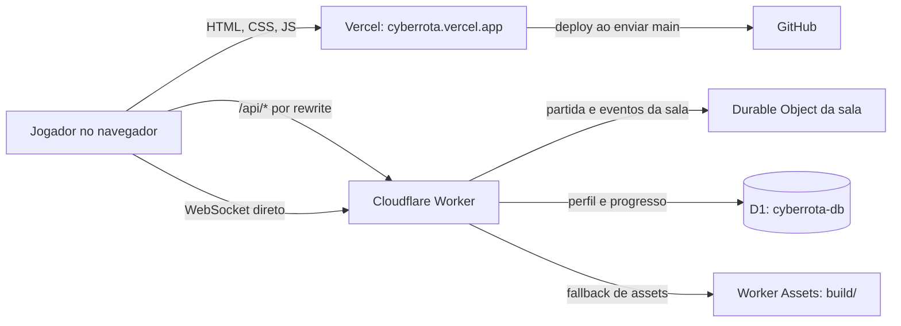
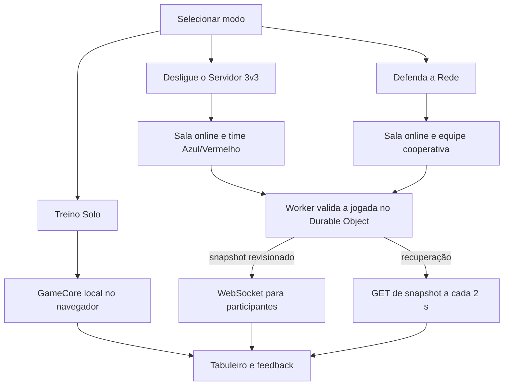
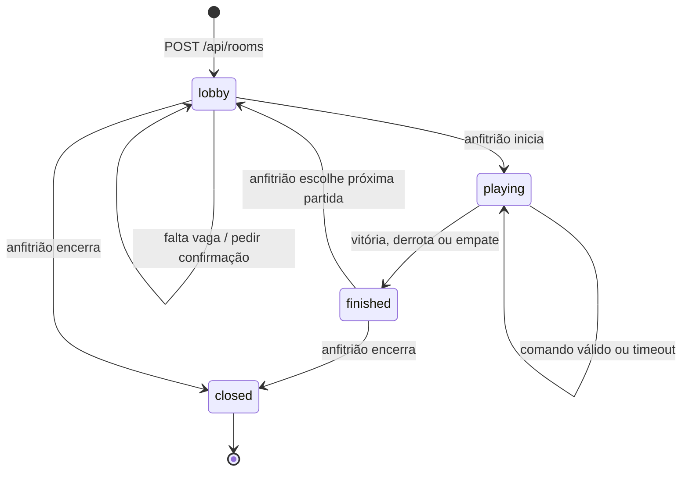
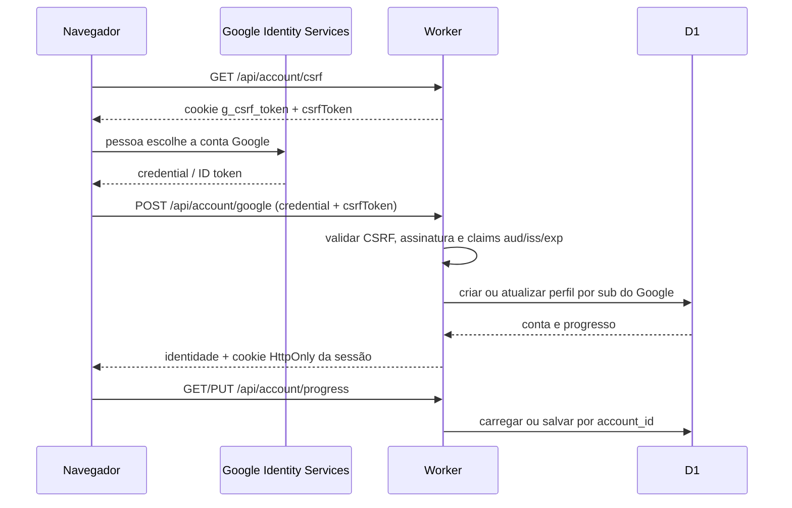
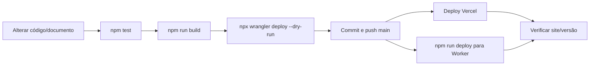

# Arquitetura e fluxos

Este documento descreve o caminho do navegador até o jogo, salas multiplayer, autenticação e dados. O [guia do jogo](guia-do-jogo.md) explica as regras para quem está jogando; as especificações em `specs/` registram decisões detalhadas e critérios SDD/TDD.

## Componentes

| Camada | Implementação | Responsabilidade |
|---|---|---|
| Interface | `dist/index.html`, `dist/app.js`, `dist/game-core.js`, `dist/room-client.js`, `dist/multiplayer-ui.js`, `dist/race-mode.js` | Navegação, tabuleiros, regras locais, renderização das salas, efeitos, perguntas e controles. |
| API pública | `worker/src/index.mjs` | Configuração pública, autenticação, APIs de conta e rotas de sala; traduz erros para respostas JSON. |
| Estado de sala | `worker/src/rooms.mjs` em um Cloudflare Durable Object por código | Mantém roster, lobby, partida, prazo, turno, respostas privadas, resultados e conexões WebSocket. |
| Persistência de conta | `server/src/accounts.js` em Cloudflare D1 | Verifica identidade Google, cria sessão da aplicação e lê/escreve progresso de conta. |
| Conteúdo | `dist/game-core.js` e baralhos/validação do app | Temas, perguntas, respostas, pontuação, rota, dano, cura e transições dos modos. |
| Publicação | Vercel e Cloudflare Workers | Vercel serve o domínio público do frontend; o Worker hospeda as APIs, estado de sala e uma cópia dos assets do build. |

O Vercel reescreve `/api/*` para `https://cyberrota.cyberrota.workers.dev/api/*`. A conexão WebSocket vai diretamente ao Worker, pois o caminho de rewrite HTTP não faz o upgrade do socket. As consultas HTTP de snapshot continuam ativas a cada dois segundos para recuperar falhas de WebSocket.



## Modos e motores



**Treino Solo** roda localmente e não envia comandos de jogo ao Worker. Ele guarda o estado de partida solo somente quando a pessoa tem uma conta autenticada.

**3v3 e Defenda a Rede** usam o mesmo serviço de sala. O cliente envia uma intenção (por exemplo `game.roll`); o servidor valida sala, fase, participante ativo e prazo; calcula o resultado; grava a nova revisão e distribui o snapshot. A interface exibe a mesma partida para todas as sessões.

## Fluxo de uma sala



1. `POST /api/rooms` gera um código criptograficamente aleatório com três letras e três algarismos em ordem misturada. O Durable Object recebe a inicialização da sala; a primeira pessoa se torna anfitriã.
2. `POST /api/rooms/:code/join` valida nome, cor livre, capacidade e estado `lobby`. Há seis cores. No 3v3, a pessoa entra no time menos ocupado.
3. O anfitrião edita modo/configuração e pode trocar o código no lobby. O Worker move o mesmo estado/roster para o código novo e invalida o antigo.
4. `room.start` só é aceito pelo anfitrião. Com vagas restantes, uma tentativa inicial responde `ROOM_NOT_FULL` e `requiresConfirmation`; o cliente pede confirmação e envia novamente. Defenda a Rede requer ao menos duas pessoas. O 3v3 completa seis lugares com bots.
5. Ao iniciar, a sala passa a `playing`, congela a configuração/baralho da partida e abre o tabuleiro. Os comandos do modo ficam autorizados apenas para a pessoa ativa e para a fase correspondente.
6. Fim de jogo guarda o resultado e o pódio no snapshot. O anfitrião pode reabrir `lobby` por `room.next-match` ou encerrar por `room.close`.

Uma vaga humana continua reservada se a conexão cair; o cliente reconecta usando o token privado de retomada. O código pode ser colado na URL como `?sala=CODIGO`. Ao trocar de modo ou sair da partida, o cliente limpa o parâmetro de sala para não voltar a um estado anterior por engano.

## Fluxo de turno e sincronização

```mermaid
sequenceDiagram
  participant A as Pessoa ativa
  participant C as RoomClient
  participant W as Worker
  participant D as Durable Object
  participant O as Outras sessões
  A->>C: rolar, escolher/responder ou ação válida
  C->>W: POST /api/rooms/:code/command
  W->>D: ação + identidade validada
  D->>D: autorizar fase/vez; calcular; atualizar revisão e prazo
  D-->>W: snapshot público + resultado privado do solicitante
  W-->>C: JSON atualizado
  D-->>O: room.snapshot pelo WebSocket
  C-->>A: renderizar tabuleiro, aviso, animação e áudio
  loop recuperação
    C->>W: GET /api/rooms/:code a cada 2 s
    W->>D: ler snapshot atual
    D-->>C: estado revisionado
  end
```

O Worker usa um prazo autoritativo de 20 segundos por turno. Ao vencer, um alarme do Durable Object passa a vez sem resposta nem erro e publica `[nome] PASSOU A VEZ`. A chamada seguinte é revelada depois de a mensagem acabar. O cliente ignora snapshots antigos, não repete animações/sons para a mesma revisão/rodada e pede snapshot novo quando um comando é rejeitado.

### Ações de partida

| Ação | Fase/modo | Efeito |
|---|---|---|
| `game.roll` | COOP `walk`; 3v3 `race-roll` | Sorteia o dado autoritativo do servidor: 1–3 no COOP, 1–6 no 3v3. |
| `game.choose-difficulty` | COOP `choose-difficulty` | Define dificuldade e escolhe uma pergunta para o tema sob ataque. |
| `game.answer` | `question` | Valida resposta, soma estatísticas, aplica regra de movimento/combate e publica feedback. |
| `game.skip` | Fase elegível, só participante ativo | Passa a vez sem responder; registra o aviso de passagem. |
| `game.heal` | COOP `walk` | Usa um nó de cura disponível se houver servidor danificado. |
| `game.ping` | COOP antes da dificuldade | Gasta um ponto e prepara uma dica, uma vez por jogador. |
| `game.role` | COOP com pergunta ativa | Usa Admin, Analista ou Engenheiro, respeitando disponibilidade e uso único. |
| `game.continue` | Tela de feedback/fim | Limpa feedback, inicia turno seguinte ou conclui a partida. |

Comandos de sala: `player.identity`, `room.configure`, `room.start`, `room.next-match`, `room.close` e `room.transfer-host`. O Durable Object confirma autorização do anfitrião ou participante antes de alterar o estado.

## Fluxo de contas e autenticação



Não existe senha Cyber Rota. O app não recebe senha Google; o Worker valida a credencial e assina uma sessão própria. `GOOGLE_CLIENT_ID` identifica a aplicação e pode ser público. `SESSION_SECRET` é segredo do servidor e deve ficar em `.dev.vars` local ou como secret do Worker.

Como visitante, o jogo pode ser usado sem login e os dados de perfil/progresso não são persistidos. Depois do login, o progresso da conta vem da API e é escrito em D1. O app oferece importação legada autorizada, exportação JSON e exclusão. A exclusão transfere antes salas ainda hospedadas, quando necessário.

## Modelo de dados

### D1 — dados de conta

| Tabela | Conteúdo |
|---|---|
| `accounts` | Identificador interno, `google_sub` único, e-mail/estado verificado, nome/avatar e revisão de progresso. |
| `account_stats`, `account_theme_stats` | Totais de respostas, acertos, pontos e estatísticas por tema. |
| `game_sessions` | Resumo de partidas concluídas da conta. |
| `answer_errors` | Cartas erradas e resposta escolhida para o caderno. |
| `custom_decks` | Baralhos personalizados da conta. |
| `saved_games` | Partidas Solo salvas por dispositivo. |
| `used_questions` | Questões já usadas na progressão da conta. |
| `guest_imports` | Chaves/tokens que tornam importações idempotentes. |
| `account_rooms` | Associação privada entre conta, pessoa da sala e função de anfitrião. |

O DDL está em `server/migrations/0001_accounts.sql`. Chaves estrangeiras removem progresso ligado a uma conta excluída.

### Durable Object — dados de sala

Cada código identifica um Durable Object com status, modo/capacidade, anfitrião, roster, conexões, configuração, revisão e jogo autoritativo. O jogo mantém fase, prazo, turno, rolagem, cartas, resposta, pontuação, integridade, PV e efeitos. Baralho, gabarito, respostas aceitas, tokens de retomada e IDs de conta ficam fora do snapshot público. Uma sala expira depois de 24 horas sem atividade.

## APIs

| Método e caminho | Função |
|---|---|
| `GET /api/config` | Retorna apenas a configuração pública (Client ID Google opcional). |
| `GET /api/account/csrf` | Emite token e cookie de CSRF para login Google. |
| `POST /api/account/google` | Valida credencial e cria sessão autenticada. |
| `POST /api/account/logout` | Apaga cookie de sessão. |
| `GET /api/account/me` | Retorna identidade da conta ativa. |
| `GET`, `PUT /api/account/progress` | Lê/escreve progresso autenticado, com revisão otimista. |
| `POST /api/account/import-guest` | Importa progresso legado de modo idempotente. |
| `GET /api/account/export` | Baixa um backup JSON dos dados da conta. |
| `DELETE /api/account` | Apaga conta e progresso após tratar salas hospedadas. |
| `POST /api/rooms` | Cria lobby e retorna código. |
| `GET /api/rooms/:code` | Lê snapshot público. |
| `POST /api/rooms/:code/join` | Entra ou reconecta à sala. |
| `POST /api/rooms/:code/rotate` | Gera código novo para a mesma sala (anfitrião). |
| `POST /api/rooms/:code/command` | Envia ação de lobby, partida, continuidade ou encerramento. |
| `GET /api/rooms/:code/ws` com `Upgrade: websocket` | Recebe atualizações/eventos da sala. |

Erros de API têm identificador estável e mensagem segura; snapshots de sala não incluem os campos privados do jogo.

## Arquivos principais

```text
dist/
  game-core.js          regras compartilhadas e transições de jogo
  app.js                navegação e interface principal
  room-client.js        HTTP, WebSocket, polling e render do lobby
  multiplayer-ui.js     integração de snapshots na tela de jogo
  race-mode.js          tabuleiro e interface do modo 3v3
worker/src/
  index.mjs             rotas de API e entrada do Worker
  rooms.mjs             estado, regras e Durable Object das salas
server/src/
  accounts.js           login Google, sessões e acesso a D1
server/migrations/      schema e migrations de conta
tests/                  testes de regra, salas, API, cliente e contrato visual
specs/                  especificações SDD, aceite e auditoria do produto
```

## Desenvolvimento local

1. `npm install` instala Vite e Wrangler.
2. Para só visualizar a UI, `npm run dev` inicia Vite com raiz em `dist/`.
3. Para executar API e sala local, copie `.dev.vars.example` para `.dev.vars`; preencha `SESSION_SECRET` com 32 caracteres ou mais.
4. `npm run dev:worker` gera `build/`, aplica migration local e inicia Wrangler. Google login pode ficar sem configuração; visitante e multiplayer local continuam disponíveis.
5. `npm test` executa testes unitários/contratuais; `npm run build` gera assets; `npx wrangler deploy --dry-run` verifica bindings/bundle.
6. Para publicar o Worker autorizado, configure segredos/Client ID no ambiente e execute `npm run deploy`. O push para `main` publica o frontend pelo GitHub/Vercel.



## Limites documentados

- A prévia de impressão mostra apenas uma parte do conjunto; não é um pacote completo Print & Play. Veja `docs/print-and-play.md`.
- Visitantes não sincronizam progresso entre navegadores. Login Google é necessário para progresso de conta.
- A atualização por WebSocket pode ser recuperada via polling HTTP, mas polling não substitui testes do transporte em duas sessões.
- Dados de salas são temporários, têm ciclo de vida limitado e não substituem histórico de conta.
