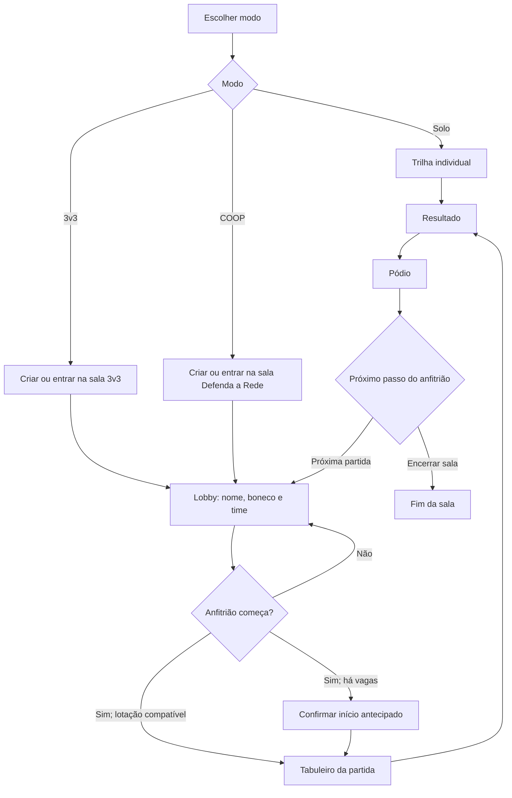

# Guia do jogo

Cyber Rota ensina fundamentos de redes por perguntas e objetivos de tabuleiro. Cada pergunta mostra uma explicação depois da resposta. Há cinco temas: Física & Enlace, Rede, Transporte, Aplicação e Segurança. As cartas têm dificuldade Fácil, Média ou Difícil.

## Escolha um modo

| Modo | Onde joga | O que fazer |
|---|---|---|
| **Treino Solo** | Uma pessoa, no próprio navegador | Colete cinco selos e conclua a rota dentro do limite de turnos. |
| **Desligue o Servidor · 3v3** | Sala online, até seis pessoas | Os times Azul e Vermelho disputam quem chega primeiro com todos os três peões ao estande rival. |
| **Defenda a Rede** | Sala online, de duas a seis pessoas | Proteja os servidores, avance até o relé e derrote o Hacker. |

Em salas online, cada pessoa controla apenas a própria vez. O servidor valida quem pode rolar, escolher dificuldade, responder, curar ou usar um recurso.

## Regras compartilhadas

- Um turno dura **20 segundos** desde o início. Nos últimos cinco segundos, a tela mostra a contagem de aviso. O mapa continua visível e os controles permanecem disponíveis.
- A pessoa ativa vê **SUA VEZ!!!**; as demais veem **VEZ DE [nome]**. Se o prazo acabar, aparece **[nome] PASSOU A VEZ**; depois que esse aviso termina, o próximo turno é anunciado.
- Expirar o prazo passa a vez sem escolher uma resposta aleatória e sem registrar erro.
- Dificuldades valem 1, 2 e 3 pontos para Fácil, Média e Difícil. Uma resposta errada recebe explicação e fica no caderno de erros da conta, quando a pessoa está conectada.
- O dado, os resultados e as respostas de partida online são decididos pelo servidor. A conexão usa WebSocket e consulta periódica de recuperação.

## Treino Solo

1. Role o dado, que avança de uma a três casas.
2. A rota vai da casa 0 à 18. Os checkpoints aparecem nas casas 3, 6, 9, 12 e 15, um para cada tema.
3. O movimento para no próximo checkpoint sem selo. Escolha a dificuldade e responda.
4. Acertar concede pontos e o selo daquele tema. Errar registra a carta para revisão; a próxima oportunidade daquele tema pode usar dificuldade menor.
5. Com os cinco selos, chegue à casa 18 para vencer. A sessão termina como treino se os 20 movimentos acabarem antes disso.

Casas especiais mudam uma jogada: **Roteador** oferece uma rota segura ou um atalho difícil; **Congestionamento** cancela o movimento; **Firewall** pode bloquear o próximo movimento após erro; **Broadcast** oferece pontos extras; **Ping** troca um ponto por uma dica; **Subnetting** gera um exercício de sub-rede.

## Desligue o Servidor · 3v3

### Preparação

Crie uma sala 3v3 e compartilhe o código/link. O tabuleiro tem seis lugares fixos, três por time. Pessoas entram nos times para equilibrá-los. A equipe Azul começa num extremo do caminho e a Vermelha no outro.

Se o anfitrião iniciar com lugares vazios, o jogo pede confirmação e completa os lugares restantes com bots. Uma partida precisa de seis participantes somando pessoas e bots.

### Uma jogada

1. Os times alternam, começando pelo Azul. Dentro de cada equipe, os três participantes jogam em ordem.
2. Só a pessoa indicada pode rolar o dado de seis faces e responder.
3. Acerto: o peão ativo avança o valor do dado em direção ao estande rival.
4. Erro: se o peão já avançou, recua uma casa em direção ao próprio estande; ao mesmo tempo, o jogador adversário correspondente avança uma casa.
5. As posições ficam entre as casas 0 e 18. Um avanço individual não desliga o servidor.

Vence a equipe que levar os três peões ao estande adversário. Se ninguém completar o objetivo após 60 turnos, há empate. A tela de vitória mostra o tabuleiro, o estado dos servidores e as animações de encerramento.

## Defenda a Rede

### Preparação e meta

De duas a seis pessoas entram na sala. A equipe protege cinco servidores, cada um inicialmente com 100% de integridade. O Hacker fica no relé externo, com PV conforme o desafio escolhido: Curta começa com 16, Normal com 20 e Desafio com 25. A rota compartilhada tem 19 casas; os pontos verdes de recuperação ficam nas casas 3, 11 e 15.

Vença levando o peão ao relé e reduzindo os PV do Hacker a zero. Se ele chegar a zero antes de a equipe alcançar o relé, fica com 1 PV até a chegada. A equipe perde quando três servidores chegam a zero ou o limite de rodadas termina: 20 em Curta, 24 em Normal e 27 em Desafio.

### Uma rodada

1. O jogo escolhe o setor sob ataque e anuncia quem joga.
2. A pessoa ativa pode rolar de um a três. O resultado é usado para escolher a dificuldade e definir quanto o peão pode avançar se acertar.
3. Acerto: o peão anda o resultado do dado (sem passar da chegada), o servidor sob ataque recupera 25% e o Hacker recebe 2, 3 ou 4 de dano conforme a dificuldade Fácil, Média ou Difícil.
4. Erro: o peão não avança; o Hacker carrega, dispara e causa dano ao servidor sob ataque. Erros somam alertas. A cada três alertas, o servidor com menos integridade perde outros 25% e os alertas reiniciam.
5. Em Desafio, o erro também recupera 2 PV do Hacker (até o máximo inicial) e causa 25% a mais de dano no servidor atacado.

### Cura e recursos da equipe

- Cada casa de cura pode ser usada uma única vez e recupera 25% do servidor mais danificado. A equipe precisa estar nessa casa e ter um servidor abaixo de 100%.
- **Admin** pode trocar uma pergunta ativa por outra elegível; **Analista** remove duas alternativas incorretas quando há alternativas suficientes; **Engenheiro** revela uma dica. Cada papel pode ser usado uma vez pela equipe na partida. Uma ação indisponível não consome o papel.
- **Ping** custa um ponto, pode ser usado uma vez pela pessoa antes de escolher a dificuldade e prepara uma dica.
- Respostas corretas danificam o Hacker e destacam as placas de armadura que caem. Cura pode mostrar as peças retornando. O painel do Hacker mostra nome e PV; o feixe, impacto, fogo, dano, explosão e áudio acompanham os eventos.

## Criar ou entrar em uma sala online

1. Abra **Desligue o Servidor** ou **Defenda a Rede** e escolha criar uma sala ou entrar.
2. O sistema gera o código; ele tem seis caracteres, com três letras e três números, em ordem misturada. O anfitrião pode copiar o código/link ou gerar outro enquanto a sala está no lobby.
3. No lobby, cada pessoa escolhe nome e um personagem/cor que ainda esteja livre. A cor aparece como boneco e não pode ser duplicada.
4. A coroa identifica o anfitrião. O lobby atualiza a lista de pessoas conectadas e o anfitrião pode ajustar o modo/vagas quando compatível.
5. Só o anfitrião começa a partida. Se ainda houver lugares na capacidade configurada, o app pede confirmação de início antecipado. Defenda a Rede exige no mínimo duas pessoas; o 3v3 preenche os lugares restantes com bots.
6. Ao começar, o modal do lobby dá lugar ao tabuleiro do modo. O código também fica visível na partida.

Cada pessoa pode voltar pelo link ou digitar o código. A sala guarda seu lugar para reconexão. Trocar o código invalida o antigo e mantém participantes e partida/lobby associados ao novo.

## Resultado, pódio e próximos passos

No final, todos veem o resultado do modo e um pódio com as três melhores pessoas; bots não entram na classificação. O pódio soma pontos pelas respostas certas (Fácil 1, Média 2, Difícil 3), depois usa número de acertos, menor número de erros e ordem dos assentos para desempatar. Cada degrau mostra boneco, nome, pontos, acertos, erros e distribuição por dificuldade.

- O anfitrião pode **Próxima partida**, que conserva código e pessoas humanas e reabre o lobby, ou **Encerrar sala**, que fecha o código.
- O participante anfitrião tem acesso imediato às ações. Visitantes podem voltar ao início após a contagem de cinco segundos; se o anfitrião estiver ausente, o resultado informa que a sala foi finalizada.

## Contas e dados

O jogo funciona como visitante e não exige login. O login Google é opcional; não há senha Cyber Rota. Conectada à conta, a pessoa sincroniza estatísticas, histórico, erros, baralhos personalizados e partidas Solo salvas, além de exportar ou apagar seus dados. Em modo visitante, esses dados ficam apenas na memória da sessão e não são sincronizados.

A imagem e o nome do perfil vêm da conta Google. A equipe nunca recebe a senha Google: o servidor verifica o token, cria uma sessão própria e guarda o progresso no banco.

## Acessibilidade e interação

- É possível silenciar música e efeitos em conjunto.
- O áudio do navegador começa após a primeira interação com a página, conforme as regras de reprodução automática do navegador.
- Movimentos reduzidos são respeitados. Informações do Hacker, vida, turno, dado e resultado também aparecem em texto e não dependem só da cor ou do som.

## Imprimir

A área **Versão impressa** oferece uma prévia de tabuleiro e cartas; ela ainda não equivale a um pacote completo de impressão e recorte. Veja [Print & Play](print-and-play.md) para as limitações e etapas pendentes.

## Diagramas rápidos

